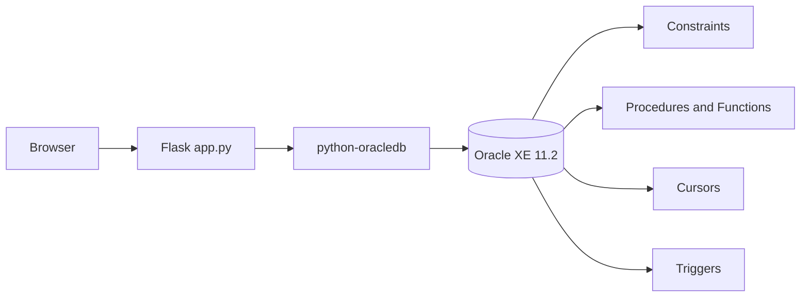
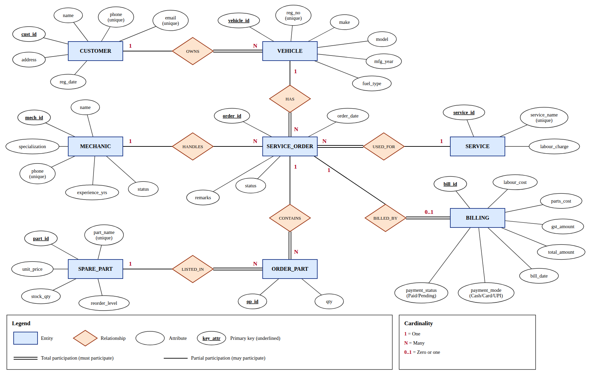
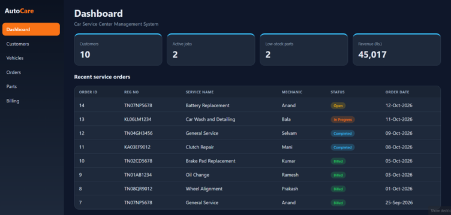
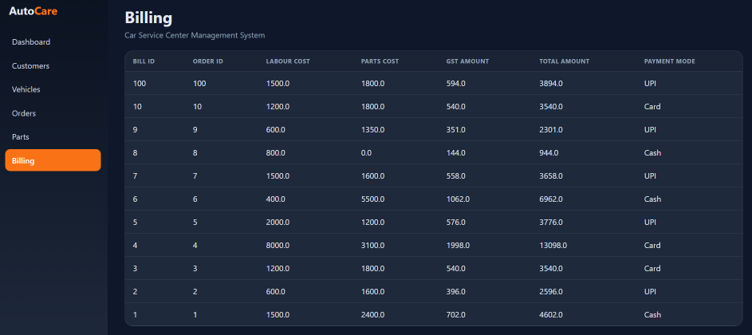
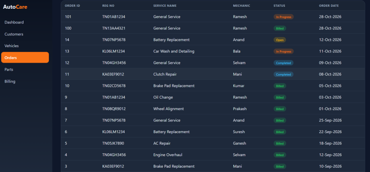
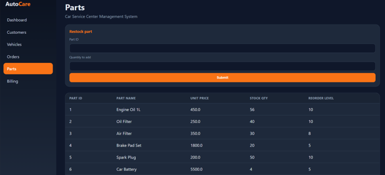

# 🚗 AutoCare – Car Service Center Management System


A database-driven web application for a car service center. It manages customers, vehicles, mechanics, service orders, spare-part inventory and GST billing. The business rules live **inside the Oracle database** (constraints, stored procedures, functions, cursors and triggers), and a Flask website lets users operate the system.

> Course project – **BCSE302L Database Systems**, B.Tech CSE (Cyber Security).

---

## ✨ Features

- Register customers and vehicles with validated, unique data
- Create service orders – the **least-loaded available mechanic is assigned automatically**
- Add spare parts to an order – **stock is checked and reduced by a trigger**, and insufficient stock is rejected
- Track order status: `Open → In Progress → Completed → Billed`
- Generate invoices (labour + parts + **18% GST**) with payment mode (Cash / Card / UPI)
- **Bulk-bill** all completed orders using an explicit cursor
- Dashboard with live customers, active jobs, low-stock parts and revenue
- Low-stock and revenue reports

## 🛠 Tech Stack

| Layer | Technology |
|---|---|
| Database | Oracle Database XE 11.2 (SQL, PL/SQL) |
| Backend | Python 3, Flask |
| Database driver | python-oracledb (thick mode) |
| Frontend | HTML, CSS (Jinja2 templates) |
| Tools | SQL*Plus, VS Code, Git |

## 🏗 Architecture



**Flow:** User operation → Flask route → SQL/PL/SQL call → Oracle processing (constraints, triggers) → database update or retrieval → result shown on the page.

## 🗄 Database Design

### ER Diagram


### Tables (8)

`CUSTOMERS` · `VEHICLES` · `MECHANICS` · `SERVICES` · `SPARE_PARTS` · `SERVICE_ORDERS` · `ORDER_PARTS` · `BILLING`

Each table has a primary key, 7 foreign keys link them, and `UNIQUE`, `NOT NULL`, `CHECK` and `DEFAULT` constraints protect the data. IDs come from sequences (Oracle 11g has no identity columns). The schema is in 3NF.

### PL/SQL components

| Component | Implementation |
|---|---|
| **Functions (4)** | `get_labour_charge`, `calculate_parts_cost`, `calculate_service_cost`, `get_mechanic_workload` |
| **Procedures (4)** | `create_service_order`, `add_part_to_order`, `complete_order`, `generate_bill` |
| **Cursors (2)** | `bill_all_completed` (explicit cursor), `low_stock_report` (cursor FOR loop) |
| **Triggers (3)** | `trg_reduce_stock`, `trg_mechanic_status`, `trg_bill_status` |
| **SQL queries** | 17 queries: joins, aggregates, `GROUP BY` / `HAVING`, subqueries, `MINUS`, date and regex functions |

## 📸 Screenshots

| Dashboard | Billing |
|---|---|
|  |  |

| Service Orders | Spare Parts |
|---|---|
|  |  |

## 🚀 Getting Started

### Prerequisites
- Oracle Database XE 11.2 (newer Oracle versions also work)
- Python 3.9 or later
- Oracle client libraries (installed with XE; folder containing `oci.dll`)

### 1. Create the database objects
```bash
sqlplus your_user/your_password @database/car_service_center.sql
```
This creates the tables, sequences, sample data, functions, procedures, cursors and triggers. It can be re-run safely.

### 2. Run the website
```powershell
cd website
python -m pip install -r requirements.txt

$env:DB_USER="your_user"
$env:DB_PASS="your_password"
$env:DB_DSN="localhost/XE"
$env:ORACLE_CLIENT="C:\oraclexe\app\oracle\product\11.2.0\server\bin"

python app.py
```
Open **http://127.0.0.1:5000**. On Linux/macOS use `export DB_USER=...` instead of `$env:`.

> Credentials are read from environment variables and are never stored in the code.

### Troubleshooting

| Error | Fix |
|---|---|
| `DPY-3010` | Oracle 11g needs thick mode – check `ORACLE_CLIENT` and that Python and the client are both 32-bit or both 64-bit |
| `ORA-12514` | Wrong service name – XE 11.2 uses `localhost/XE` |
| `ORA-00942` | Run `database/car_service_center.sql` first, as the same user |
| `TemplateNotFound` | `page.html` must be inside the `templates` folder |

## 🔁 Example Transaction

1. Register a customer and a vehicle
2. Create a service order → `create_service_order` assigns a mechanic, `trg_mechanic_status` sets them to *Busy*
3. Add a spare part → `add_part_to_order`, `trg_reduce_stock` lowers the stock
4. Complete the order → `complete_order`, mechanic becomes *Available*
5. Generate the bill → `generate_bill` uses the cost functions, `trg_bill_status` marks the order *Billed*
6. Press **Bill all completed orders** → the explicit cursor bills every completed order

## 📁 Project Structure

```
car-service-center/
├── README.md
├── .gitignore
├── database/
│   ├── car_service_center.sql    # tables, data, queries, procedures, cursors, triggers
├── website/
│   ├── app.py                    # Flask application
│   ├── requirements.txt
│   └── templates/
│       └── page.html
├── docs/
│   ├── ER_Diagram.png
└── screenshots/
```

## ⚠️ Known Limitation & Future Scope

- A mechanic is set to *Available* when any of their orders completes, even if they have another job in progress. A compound trigger or workload check would fix this.
- Future scope: appointment booking, supplier purchase orders, SMS reminders, user login with roles, dashboard charts.

## 👩‍💻 Author

**Sanjana K** 
